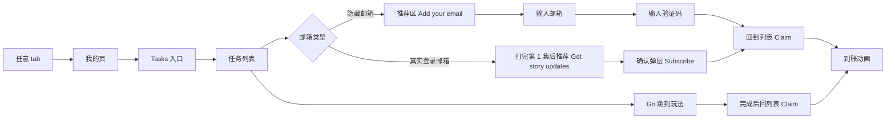

<title>Lunaverse 任务列表与 Apple 绑定邮箱 PRD v0.1</title>

| 版本 | v0.1 草稿，待评审 |
|-|-|
| 更新日期 | 2026-11-04 |
| 负责人 | 产品 [待填]，设计 [待填]，客户端 [待填]，后端 [待填]，数据 [待填] |
| 设计稿 | [Figma 任务列表 & 绑定邮箱 1104 / Tasks Section 1](https://www.figma.com/design/XeuFxRu06jkMunxq9nDM5A/LUNAVERSE-APP?node-id=7018-746) |
| 相关文档 | [Tutor v1.1](https://xcn662409uz0.feishu.cn/docx/XEUAddRzIoyOH1xj14yc5RrVnDc)、[Key Message 体系](https://xcn662409uz0.feishu.cn/docx/X08Hde9EZoiqjlxUTEIclpzonIe) |

# 这版要做什么

用一张任务列表，把新用户带到我们最希望他们体验的玩法上，每条任务对应一个 Key Message 里的用户里程碑。同时让使用 Apple 隐藏邮箱的用户绑定一个真实邮箱。新用户第一次进首页已经连续看到 Claim 和 Discord 两个弹窗，所以绑定邮箱不再弹窗，靠小红点和任务列表的推荐区引导。

| 模块 | 线上现状（1.0.12） | 这一版 |
|-|-|-|
| 我的页入口 | Login bonus、Invite friends 两个入口 | Tasks、Login bonus 两张卡片，标题加动态描述，去掉黄色角标。Invite friends 收进任务列表 |
| 底部 me tab | 无红点 | 有可领奖励或隐藏邮箱未绑定时显示红点，三个 tab 下都可见 |
| 任务列表 | 无 | 新增，分推荐、每日、邀请、里程碑、社区五个区 |
| 绑定邮箱 | 账号资料页有入口，但 Apple 用户基本绑不了 | 隐藏邮箱用户可以从任务进入，后端放开限制 |
| 邮件订阅 | 无 | 有真实登录邮箱的用户可以一键订阅更新，不用验证码 |
| 邀请好友 | 填码和发奖都限注册后 7 天，只能复制邀请码，双方各 2,000，邀请人再 2,000（按 100 倍算） | 填码限 48 小时，发奖限 7 天，加系统分享和进度。被邀请人 1,000，邀请人共 3,000，每月最多 10 位朋友 |

# 已定的决策

- **绑定邮箱任务只给 Apple 隐藏邮箱用户。**有真实登录邮箱的用户（Apple 真实邮箱、Google、Facebook、邮箱老账号）走一键订阅，不用再验证一次。两条任务每个账号只会看到一条，奖励都是 500。
- **不增加弹窗。**引导只靠 me tab 红点、Tasks 入口红点和推荐区排序。
- **邮箱用来发新故事更新和召回。**这是营销邮件，要有同意说明和退订，隐私政策也要先改。
- **任务按 Key Message 拆。**覆盖掷骰、角色互动、Remix 与梦境、多故事，任务的目的是鼓励用户完成这些里程碑。
- **订阅和送礼奖励更高。**这两项是真花钱的行为，订阅送 2,000，送礼送 500，都不会返到免费。
- **第一版不放好评换 Moons，也不放次日回来。**苹果规定不能用奖励换评价；次日回来和签到第 2 天重复。
- **完成后手动领取。**沿用 Claim 和现有到账动画。
- **邀请机制参考 Tipsy，但保留打完一集才发奖。**Tipsy 填码就发，Reddit 上已经有版主让自动审核先删帖再复核，也有人说发码的是机器人账号。

# 现状和依据

统计 10-28 投放以来注册的 327 人，数据截至 11-04，来自 Metabase，未排除内部测试账号。Apple 登录 196 人里，隐藏邮箱 143 人（73%），真实邮箱 52 人（27%），没有邮箱 1 人。全部用户里隐藏邮箱 143 人（44%）能做绑定任务，有真实登录邮箱的 161 人（49%）能做订阅任务，其余主要是游客。

**Apple 用户现在绑不了邮箱，这是前置问题。**Apple 给的邮箱（包括隐藏邮箱）登录时就记成账号邮箱。客户端发现已有邮箱就不打开绑定页（AccountProfilePhase），后端也会拒绝绑定另一个邮箱（assertAccountCanBindEmail）。后端代码读的是 main，最新提交 10-22，线上要再核对。

| 用户行为 | 已做到 | 占比 | 说明 |
|-|-|-|-|
| 掷过骰 | 76 | 23% |  |
| 掷过 3 次 | 37 | 11% | 成功 3 次的人数少于这个数 |
| 失败 3 次 | 约 8 | 2% | 用接受失败和直接通过估算，偏低 |
| 失败 10 次 | 1 | 0.3% | 所以第一版不放 |
| 打完 1 / 3 / 5 集 | 55 / 24 / 9 | 17% / 7% / 3% |  |
| 在两部作品各打完 1 集 | 13 | 4% |  |
| 打到完整结局 | 1 | 0.3% |  |
| 点赞作品 | 13 | 4% |  |
| Remix | 26 | 8% |  |
| 和角色聊过 | 7 | 2% |  |
| 送过礼 | 1 | 0.3% |  |
| 订阅角色 | 0 | 0% |  |
| 关注角色、动态互动、打开主动消息、进入梦境 | 查不到 |  | 现在没有可用的埋点 |

# 任务清单

奖励是 100 倍后的数字（方案见 Tutor v1.1 第 3 节，待确认），也是产品提议，评审可调。如果不做通胀，全部除以 100。任务 ID 给后端和埋点用。

| 分区 | 任务（英文文案） | 任务 ID | 入口短名 | 奖励 | 完成条件 | 按钮跳到 |
|-|-|-|-|-|-|-|
| 推荐 | Add your email | account_link_email | Link email | 500 | 隐藏邮箱用户验证通过新邮箱 | 绑定邮箱页 |
| 推荐 | Get story updates | account_subscribe_updates | Get updates | 500 | 有真实登录邮箱的用户确认订阅 | 订阅确认弹层 |
| 每日 | Claim your login bonus | daily_check_in | 不在入口显示 | 显示当日签到额 | 领取当日签到，不另外加奖励 | 签到页 |
| 每日 | Finish 1 episode | daily_episode | Play 1 episode | 200 | 当天打完 1 集 | 继续上次的作品 |
| 每日 | Roll the dice once | daily_roll | Roll once | 100 | 当天掷骰 1 次 | 继续上次的作品 |
| 每日 | Remix or chat once | daily_remix_or_chat | Remix or chat | 100 | 当天完成 1 次 Remix 或发 1 条 Bubble 消息 | 继续上次的作品 |
| Stories | Finish Episode 1 | story_ep1 | Episode 1 | 400 | 累计打完 1 集 | 继续上次的作品 |
| Stories | Finish 3 episodes | story_ep3 | 3 episodes | 600 | 累计打完 3 集 | 继续上次的作品 |
| Stories | Finish 5 episodes | story_ep5 | 5 episodes | 1,000 | 累计打完 5 集 | 继续上次的作品 |
| Stories | Like a story | story_like | Like a story | 200 | 点赞一部作品 | 首页 |
| Stories | Play a second story | story_second | New story | 600 | 在第二部作品打完 1 集 | 首页 |
| Stories | Reach a story ending | story_ending | Story ending | 1,000 | 打到一部作品的完整结局，可叠加现有结局奖励 | 继续上次的作品 |
| Dice | Roll your first dice | dice_first | First roll | 200 | 第一次掷骰 | 继续上次的作品 |
| Dice | Win 3 rolls | dice_win3 | Win 3 rolls | 400 | 累计成功 3 次，重投成功也算 | 继续上次的作品 |
| Dice | Lose 3 rolls | dice_lose3 | Lose 3 rolls | 200 | 累计最终失败 3 次 | 继续上次的作品 |
| Dice | Reroll once | dice_reroll | Reroll | 200 | 第一次重投，免费和付费都算 | 继续上次的作品 |
| Dice | Use Direct Pass once | dice_direct_pass | Direct Pass | 200 | 第一次直接通过 | 继续上次的作品 |
| Characters | Follow a character | char_follow | Follow | 200 | 关注一位角色 | Moments |
| Characters | Like or comment on a post | char_post | Moments | 200 | 点赞或评论一条角色动态 | Moments |
| Characters | Send your first message | char_message | First chat | 400 | 在 Bubble 发出第一条消息 | Bubble |
| Characters | Open a message from a character | char_open_proactive | Read message | 200 | 打开一条角色主动发来的消息 | Bubble |
| Characters | Send a gift with Moons | char_gift | Send a gift | 500 | 用 Moons 送礼，解锁送的免费礼物不算 | Bubble |
| Characters | Subscribe to a character | char_subscribe | Subscribe | 2,000 | 订阅任意一位角色 | Bubble 订阅页 |
| Remix & Dreams | Make your first Remix | remix_first | First Remix | 400 | 第一次完成 Remix | 继续上次的作品 |
| Remix & Dreams | Finish 3 Remixes | remix_3 | 3 Remixes | 600 | 累计完成 3 次 Remix | 继续上次的作品 |
| Remix & Dreams | Enter a Dream | dream_enter | Enter a Dream | 400 | 进入一个梦境 | 我的页 Dream |
| 邀请 | Invite a friend | invite_friend | Invite | 每位朋友最多 3,000 | 沿用邀请规则发奖，这条任务只做入口，可重复 | 邀请弹层 |
| 邀请 | Enter an invite code | invite_enter_code | Enter code | 1,000 | 注册 48 小时内填码，之后打完一集 | 邀请弹层 |
| 社区 | Join our Discord | community_discord | Join Discord | 1,000 | 点击即算，和 Tutor v1.1 的 Discord 弹窗共用一次奖励 | Discord |
| 社区 | Follow us on Instagram | community_instagram | Instagram | 200 | 点击即算 | Instagram |
| 社区 | Follow us on TikTok | community_tiktok | TikTok | 200 | 点击即算 | TikTok |
| 社区 | Follow us on X | community_x | Follow on X | 200 | 点击即算 | X |

- **和 Key Message 的对应。**Dice 对应 K1、K2，Characters 对应 K3，Remix & Dreams 对应 K4，Stories 对应 K5。K4 里的梦境类型、保存和分享是创作链路上的细节，这版不拆成任务。
- **总量。**里程碑全做完 9,900，占最小包 495%。按现在的到达人数估算，平均每个注册用户约 300，占最小包 15%。任务上线后人数变多，这个数会涨。
- **每日上限。**不含签到每天 400，占最小包 20%。每天做满 30 天多 12,000，约 86% 个 \$9.99 档，加上签到后 30 天免费总量从 304% 涨到约 390%。以后开始有人付费，先砍签到，再砍每日任务。
- **Bubble 成本。**做任务能更快攒够 5,000 开 Bubble 首月，这是想要的结果，但每个免费订阅都有模型成本，上线后要盯。隐藏邮箱用户当天做完绑定、第 1 集和两个掷骰任务，加上第一天的 3,600 共 5,100，刚好够开。

# 用户流程

# 需求详述

## Apple 绑定邮箱的后端前置

| 编号 | 行为 | 验收标准 |
|-|-|-|
| B1 | 判断隐藏邮箱用户，条件是登录方式为 Apple 且账号邮箱以 @privaterelay.appleid.com 结尾。结果由后端下发给客户端 | 真实邮箱的 Apple 用户、Google 和 Facebook 用户判断为否 |
| B2 | 隐藏邮箱用户可以绑定一个新邮箱。新邮箱单独存为联系邮箱，不替换 Apple 登录身份，这是建议做法，后端可调整 | 绑定后仍能用 Apple 登录同一账号；账号的隐藏邮箱保留 |
| B3 | 沿用现有验证码接口（users/me/email/start、verify、resend）和频率限制 | 验证码错误、过期、发送过频都有提示，不发奖 |
| B4 | 新邮箱已被其他账号使用时拒绝绑定 | 提示邮箱已被使用，任务状态不变 |
| B5 | 客户端账号资料页的判断同步调整，隐藏邮箱用户也能打开绑定页 | 资料页和任务进入的是同一个流程，绑定后显示新邮箱 |
| B6 | 记录营销同意状态，包括同意时间、文案版本、邮箱来源（绑定或登录邮箱）和退订时间。绑定成功或确认订阅时记录同意 | 能查到每个联系邮箱的同意和退订记录 |
| B7 | 每封营销邮件带退订链接，退订后不再发送。退订不影响账号和已领奖励 | 点退订后不再收到；奖励不被收回 |

## 红点和入口

<grid>
<column width-ratio="0.500000">

</column>
<column width-ratio="0.500000">
| 编号 | 行为 | 验收标准 |
|-|-|-|
| R1 | 底部 me tab 在任意 tab 下都显示红点，条件是存在可领奖励，或用户是隐藏邮箱且未绑定 | 领完且已绑定后红点消失 |
| R2 | 隐藏邮箱未绑定带来的红点，用户打开任务列表后当天不再亮，第二天还没绑定再亮，连续亮 7 天后停止 | 打开列表后红点消失；次日重开再亮；第 8 天不亮 |
| R3 | 可领奖励带来的红点一直亮到领完 | 领完最后一个奖励后红点立刻消失 |
| R4 | 每日任务没做完不亮红点 | 只有未完成任务时不亮 |
</column>
</grid>

<grid>
<column width-ratio="0.500000">

</column>
<column width-ratio="0.500000">
| 编号 | 行为 | 验收标准 |
|-|-|-|
| R5 | 我的页头像下方是 Tasks 和 Login bonus 两张卡片，并排等宽，内容左对齐，图标在左，右边上行标题、下行描述。去掉 Login bonus 的黄色角标，Invite friends 收进任务列表，Tipsy 也是这样放的 | 两张卡片在 393 宽屏幕等宽不换行；我的页没有角标，也没有 Invite friends |
| R8 | Tasks 描述按顺序取第一条。有奖励可领，显示 Claim 加可领合计；隐藏邮箱未绑定，显示 Link email +500；有未完成的推荐任务，显示任务短名和奖励；今天还有每日任务，显示每日任务短名和奖励；都做完了，显示 Today's tasks done | 每种状态显示正确；领取或完成后回到我的页立刻刷新 |
| R9 | Login bonus 描述。今天有可领的，显示 Claim 加可领合计，包含累计宝箱和之前没领的；今天领过了，显示 Tomorrow 加下一次登录能领的数额 | 未领多天时合计正确；领取后立刻变成 Tomorrow |
| R10 | 描述里的 Moons 数额用黄色。文字过长时单行截断，不换行。短名由后端下发，见任务清单 | 最长的描述在 393 宽屏幕不换行，不压到红点 |
| R11 | 红点只出现在 Tasks 卡片和 me tab。Login bonus 不加红点，靠黄色数额提示。绑定提示被 Claim 盖住时，领完后自动回到 Link email | 有可领奖励时显示 Claim；领完后隐藏邮箱用户显示 Link email |
| R6 | Tasks 入口红点和 me tab 红点同一套条件 | 两处红点同时亮灭 |
| R7 | 顶部余额胶囊要能放下四到六位数。现在宽度固定，3,000 会折成两行 | 余额 90,000 不折行、不和左侧重投胶囊重叠 |
</column>
</grid>

Tasks 和 Login bonus 描述的各种状态。

## 任务列表

<grid>
<column width-ratio="0.500000">

</column>
<column width-ratio="0.500000">
| 编号 | 行为 | 验收标准 |
|-|-|-|
| T1 | 页面从上到下是推荐、每日、邀请、里程碑、社区。里程碑内再分 Stories、Dice、Characters、Remix 和 Dreams | 五个分区都能看到，社区在最后 |
| T2 | 推荐区第一版只显示 1 条，由后端按优先级下发。优先级是隐藏邮箱未绑定的绑定任务，然后是打完第 1 集，然后是未订阅的订阅任务，然后是下一个未完成里程碑，最后是当天未完成的每日任务 | 隐藏邮箱用户先看到绑定任务；其他用户先看到打完第 1 集，打完后看到订阅任务；里程碑全做完后看到每日任务 |
| T3 | 推荐区显示的任务不在下方分区重复出现；绑定和订阅任务只在推荐区出现，排到后面时暂不显示 | 任务离开推荐区后回到原来的分区 |
| T4 | 每个分区内按待领取、未完成、已完成排序。已完成的任务变灰放到分区最后 | 领取后任务移到分区最后 |
| T5 | 按钮用具体动词，比如 Play、Follow、Chat、Remix、Link，点击跳到清单里对应的玩法，完成后回到列表能领取 | 每个按钮都能到达能完成任务的页面 |
| T6 | 需要累计的任务显示进度，比如 1 / 3 | 进度和后端一致 |
| T7 | 每日任务按账户现有的换日时间刷新（当地时间凌晨 4 点） | 换日后每日任务重置，里程碑不变 |
| T8 | 进度和完成状态以后端记录为准，不靠埋点判断 | 换设备后状态不变；重复请求不会重复计数 |
| T9 | 所有任务上线后开始计数，不回溯历史行为，老用户也能做 | 老用户看到的进度从 0 开始；不补发 tutor 奖励 |
</column>
</grid>

<grid>
<column width-ratio="0.500000">

</column>
<column width-ratio="0.500000">
其他新用户的推荐区显示第一个未完成的里程碑，比如打完第 1 集。没有隐藏邮箱的用户完全看不到绑定任务。
</column>
</grid>

## 绑定邮箱流程

<grid>
<column width-ratio="0.500000">

</column>
<column width-ratio="0.500000">
| 编号 | 行为 | 验收标准 |
|-|-|-|
| E1 | 复用现有 emailLogin 窗口的绑定模式。标题 Link your email，按钮 Send Verification Code | 格式错误时提示 Enter a valid email address. |
| E2 | 说明文案从 Add an email so you can return to this account. 改成 Get new episodes and offers by email.。Tutor v1.1 去掉了邮箱登录，原文案的承诺已经不成立 | 文案和用途一致 |
| E3 | 页面上显示奖励说明 Link it and claim 500 Moons | 数额和任务一致 |
| E7 | 按钮上方显示同意说明 By linking, you agree to receive story updates and offers from Lunaverse. Unsubscribe anytime. Privacy Policy。Privacy Policy 可点击 | 点击打开隐私政策；是否要改成勾选框看开放问题第 1 条 |
</column>
</grid>

<grid>
<column width-ratio="0.500000">

</column>
<column width-ratio="0.500000">
| 编号 | 行为 | 验收标准 |
|-|-|-|
| E4 | 输入 6 位验证码，按钮 Link Email，填满前按钮置灰。沿用 Resend code 倒计时 | 验证码错误时提示 Enter the 6-digit code from your email |
| E5 | 验证通过后关闭窗口回到任务列表，不直接发奖 | 回到列表时绑定任务变成 Claim |
| E6 | 中途关闭窗口不改变任务状态 | 下次还能重新进入 |
</column>
</grid>

<grid>
<column width-ratio="0.500000">

</column>
<column width-ratio="0.500000">
| 编号 | 行为 | 验收标准 |
|-|-|-|
| C1 | 点 Claim 发放 Moons，播放现有到账动画，余额随动画更新 | 到账后任务变成 Done；失败时不变并提示重试 |
| C2 | 每个奖励只发一次，后端做幂等，按第三方账号去重，和 Tutor v1.1 的注销规则一致 | 连点或换设备不会重复到账；注销后重新注册不能再领 |
| C3 | Discord 弹窗里点过的算已领，列表显示 Done。关掉弹窗没点的，可以从列表再领 | 两边只发一次奖励 |
</column>
</grid>

## 一键订阅

<grid>
<column width-ratio="0.500000">

</column>
<column width-ratio="0.500000">
| 编号 | 行为 | 验收标准 |
|-|-|-|
| U1 | 只给有真实登录邮箱、还没订阅的用户。隐藏邮箱和游客看不到。不亮红点 | 隐藏邮箱用户不出现这条任务 |
| U2 | 打完第 1 集后排到推荐区第一，Go 打开确认弹层 | 打完第 1 集前不在推荐区 |
</column>
</grid>

<grid>
<column width-ratio="0.500000">

</column>
<column width-ratio="0.500000">
| 编号 | 行为 | 验收标准 |
|-|-|-|
| U3 | 弹层显示打码后的登录邮箱，比如 k\*\*\*@gmail.com，主按钮 Subscribe，右上关闭不改变状态 | 不展示完整邮箱；关闭后任务还在 |
| U4 | 按钮上方显示同意说明和隐私政策链接，文案和绑定页一致，只把 linking 换成 subscribing | 点击打开隐私政策 |
| U5 | 点 Subscribe 记录同意，关闭弹层，任务变成 Claim。这里不直接发奖 | 领取后才到账；只发一次 |
| U6 | 没有邮箱的账号不出现这条任务 | Facebook 没给邮箱的用户看不到 |
</column>
</grid>

## 邀请好友

现行规则来自后端 referral-service，读的是 10-22 的 main。Tipsy 任务页截图写明新用户 within 48 hours of signing up 填码，双方得奖，还提示滥用可能封号。

| 奖励 | 现在按 100 倍 | 改后 | 占最小包 | Tipsy / OOC 占最小包 |
|-|-|-|-|-|
| 被邀请人，打完一集 | 2,000 | 1,000 | 50% | 10% / 25% |
| 邀请人，朋友打完一集 | 2,000 | 1,000 | 50% | 10% / 按充值额 5% |
| 邀请人，朋友另一天再打完一集 | 2,000 | 2,000 | 100% | 无 |
| 邀请人，同一位朋友合计 | 4,000 | 3,000 | 150% |  |

- **被邀请人 1,000。**加上第一天的 3,600 是 4,600，没到 Bubble 首月的 5,000。按现在的 2,000 算是 5,600，当天就能免费开。
- **邀请人后一笔更多。**朋友真的回来更有价值，也更难刷。成功邀请 2 位朋友有 6,000，够开一个 Bubble 首月。
- **成本估算。**按 17% 打完一集、其中约三分之一回来算，每个填码用户平均发出约 450 Moons，按原价约 \$0.45。回访比例只来自一批 6 个人，这个数只能当方向。

<grid>
<column width-ratio="0.500000">

</column>
<column width-ratio="0.500000">
| 编号 | 行为 | 验收标准 |
|-|-|-|
| I1 | 被邀请人注册后 48 小时内可以填码。超时后隐藏 Have an invite code? 这一块 | 第 49 小时入口消失，接口也拒绝 |
| I2 | 填码后，注册 7 天内首次打完任意一集正式集，被邀请人和邀请人各得 1,000。重看、梦境、分支存档不算 | 双方各到账一次；填码前打完的集不算 |
| I3 | 注册 7 天内，朋友在另一天再首次打完一集，邀请人再得 2,000。按朋友所在时区判断是否换了一天 | 同一天打两集不发；第 8 天打完不发 |
| I4 | 邀请人每个自然月最多从 10 位朋友拿奖，从朋友第一笔奖励开始占额度。超出后朋友的 1,000 照发，邀请人不发也不顺延 | 第 11 位朋友打完一集，朋友到账，邀请人不到账 |
| I5 | 不能填自己的码，每个账号只能填一次。按第三方账号去重，注销后重新注册不能再填，和任务规则一致 | 自填、重复填都提示不可用 |
| I6 | 增加 Share invite，打开系统分享，文案 Use my code LYB7XP on Lunaverse to get 1,000 Moons. 加商店下载链接。原来的复制保留 | 分享和复制都能用；iOS 和 Android 跳对应商店 |
| I7 | 弹层显示已成功邀请的朋友数和已得 Moons，由后端下发 | 数字和实际到账一致 |
| I8 | Invite a friend 一直显示在邀请分区，点 Invite 打开邀请弹层，没有领取按钮，奖励沿用现有的 {moons} Moons are yours! 弹窗。Enter an invite code 只在 48 小时内且未填码时显示 | 超时后这条任务消失；到账后不重复弹 |
| I9 | 邀请弹层和任务上写明每位朋友最多可得 3,000，并提示滥用可能封号。我的页不再有邀请角标 | 文案和规则一致 |
| I10 | 达人专属码可以单独配置，被邀请人奖励 2,000，邀请人不受每月上限限制 | 普通码不受影响 |
</column>
</grid>

# 指标

基线来自第 3 节，用来和上线后对比。

| 指标 | 口径 | 当前值 |
|-|-|-|
| 隐藏邮箱绑定率 | 绑定成功的隐藏邮箱用户数 ÷ 隐藏邮箱用户数 | 0，现在绑不了 |
| 红点进入率 | 点 me tab 红点后打开任务列表的用户数 ÷ 看到红点的用户数 | 新功能，暂无 |
| 任务列表打开率 | 打开任务列表的用户数 ÷ 注册用户数 | 新功能，暂无 |
| 打完 1 / 3 / 5 集 | 打完对应集数的用户数 ÷ 注册用户数 | 17% / 7% / 3% |
| Remix 使用率 | 完成 Remix 的用户数 ÷ 注册用户数 | 8% |
| Bubble 聊天率 | 发过消息的用户数 ÷ 注册用户数 | 2% |
| 订阅人数和送礼人数 | 用 Moons 订阅或送礼的用户数 | 0 / 1 |
| 次留 | 注册第二天还有活动的用户数 ÷ 注册用户数 | 13%（Tutor v1.1 口径） |
| 任务发放 Moons | 每个注册用户平均通过任务拿到的 Moons，来自后端流水 | 估算约 300 |
| 邮件订阅率 | 确认订阅的用户数 ÷ 有真实登录邮箱的用户数 | 新功能，暂无 |
| 可触达邮箱占比 | 绑定或订阅的用户数 ÷ 注册用户数 | 0 |
| 邮件退订率 | 退订的用户数 ÷ 同意过的用户数 | 新功能，暂无 |
| 邀请分享人数 | 点过 Share invite 或复制邀请码的用户数 | 现在查不到 |
| 填码人数和填码后打完一集的比例 | 来自后端邀请记录 | 现在查不到 |

# 埋点

沿用 Tutor v1.1 第 8 节的通用事件，不新增事件名，只加取值。这套事件要先随 v1.1 上线。

| 事件 | 场景 | 取值 |
|-|-|-|
| surface_presented | 任务列表、绑定邮箱页曝光 | page_id 为 task_list、email_link_input、email_link_code、email_subscribe_sheet；source 为 red_dot、direct |
| surface_clicked | 点 me tab、Tasks 入口、Go、Claim、绑定页按钮 | page_id 为 tab_bar、me、task_list、email_link_input、email_link_code、email_subscribe_sheet；element_id 为 me、tasks、go、claim、send_code、link_email、subscribe、close；section 为 recommended、daily、milestones、community |
| reward_claim_attempt / reward_claim_result | 领取任务奖励 | claim_kind 为 task；reward_id 为任务 ID；reward_amount |
| virtual_currency_granted | Moons 到账 | reason 为 task，用 operation_id 和领取事件串起来 |
| surface_presented / surface_clicked | 邀请弹层曝光和点击 | page_id 为 invite_sheet；element_id 为 share、copy、confirm_code |
| virtual_currency_granted | 邀请奖励到账 | reason 增加 referral。现在埋点里没有这个取值 |

Go 点击时也要带任务 ID，可以放在 reward_id 里（参数已随 v1.1 进白名单）。进度和完成以后端为准，不用客户端埋点计算。关注角色、动态互动、主动消息和进入梦境现在没有可用的埋点，由后端的任务完成记录统计。

# 开放问题

| # | 问题 | 当前建议 | 需要谁确认 |
|-|-|-|-|
| 1 | 营销邮件的合规做法。现行隐私政策没有写营销邮件，还写明 Google、Apple、Facebook 账号数据只用于登录和账号相关用途。Google Play 已开放 178 个地区，欧盟等地可能要求单独勾选同意 | 上线前更新隐私政策，由法务确认同意方式和各地区要求 | 法务、产品 |
| 2 | 后端任务系统怎么做，现有成就系统能否复用 | 后端评估 | 后端 |
| 3 | 关注角色、动态互动、打开主动消息、进入梦境的完成判定来源 | 后端确认每条能否记录 | 后端 |
| 4 | 社媒和 Discord 的官方链接 | 用不过期的链接 | 运营 |
| 5 | 奖励数额依赖 Moons 100 倍方案，方案还没最终确认 | 定了之后回来改设计稿和本文 | 产品 |
| 6 | Ultra Remix 算不算 Remix 任务。它受版本开关控制 | 算，后端只看完成 Remix | 产品、后端 |
| 7 | Moments 和梦境是否对所有新用户开放。入口不存在时 Go 跳哪里 | 入口不可用时隐藏任务 | 产品、客户端 |
| 8 | 推荐区是否需要运营可配置，以后放活动任务 | 第一版后端按固定优先级，预留配置 | 产品、后端 |
| 9 | 用登录邮箱发营销邮件是否可行。现行隐私政策写明第三方账号数据只用于登录和账号相关用途，一键订阅要改政策后才能上。Google 和 Apple 的开发者条款也要一起看 | 法务确认后再开发订阅任务；不通过时退回到输入新邮箱并验证 | 法务、产品 |
| 10 | 发营销邮件的系统。后端现在只有发验证码的能力，没有退订和批量发送 | 选邮件服务并单独立项，发送内容和节奏不在这一版 | 产品、后端 |
| 11 | 规则切换时已经绑定、还在 7 天内的老邀请怎么算 | 已绑定的按旧数额折算到新单位发完，新绑定走新规则 | 产品、后端 |
| 12 | 达人专属码由谁发、怎么配置，给多少位达人 | 后端支持按码配置奖励和是否受上限限制，名单由增长定 | 增长、后端 |
| 13 | 系统分享文案里的下载链接要不要用归因链接 | 先用商店链接，归因以后再加 | 增长、客户端 |
