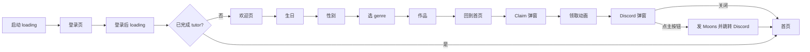

<title>Lunaverse Tutor v1.1 版本优化文档</title>

| 版本 | v1.1 草稿，待评审 |
|-|-|
| 更新日期 | 2026-11-04 |
| 负责人 | 产品 [待填]，设计 [待填]，客户端 [待填]，后端 [待填]，数据 [待填] |
| 设计稿 | [Figma 新版登录 1028 / Section 1](https://www.figma.com/design/XeuFxRu06jkMunxq9nDM5A/LUNAVERSE-APP?node-id=6919-1113)，欢迎页主视觉在[这一帧](https://www.figma.com/design/XeuFxRu06jkMunxq9nDM5A/LUNAVERSE-APP?node-id=6937-1169) |
| 上一版 | [Tutor v1.0 PRD](https://xcn662409uz0.feishu.cn/docx/XawTdDIipooCpxxQODacMLg6n3e)，本文没提到的内容沿用 v1.0 |

# 这版改了什么

v1.1 的核心是用 Moons 把新用户带完 tutor。登录页先用奖励吸引注册，欢迎页讲清楚规则，用户看完第一部作品回到首页时亲手领取，领完再邀请进 Discord。登录方式同时收窄，去掉邮箱和游客。Moons 同时乘 100，后端和老数据一起改，tutor 送 2,000，Discord 送 1,000，方案见第 3 节。

| 模块 | 线上现状（1.0.12） | v1.1 |
|-|-|-|
| 登录方式 | Apple、Google、邮箱，邮箱页里还有游客入口。iOS 1.0.12 的 Facebook 开关是关闭的 | Google、Facebook、Apple。删除邮箱和游客入口 |
| 登录气泡 | 无 | 新增 Sign up and get 2,000 moons! |
| loading | 现有 GameLoading 样式 | 换成新样式，启动时带 tips，登录后不带 |
| 欢迎页 | 无，登录后直接进生日 | 新增，大图插画配奖励说明，主按钮 Continue |
| 首页弹窗 | 首次进首页弹 Welcome to Lunaverse，文案 25 Moons are on us. | 改成 Claim 2,000 Moons，只有完成 tutor 的用户才弹 |
| Discord 弹窗 | 无 | 新增，领取动画播完后弹，点按钮即送 1,000 Moons |
| 注册奖励 | 注册时发 30 Moons | 注册不发，改为完成 tutor 后领取 |
| Moons 面额 | 1 美元约 10 到 18 个 | 统一乘 100，后端和老数据一起改，待确认 |

# 已定的决策

- **保留 Facebook 登录。**
- **气泡只负责把人带进来。**文案写注册就送，实际领取必须完成 tutor，这是有意设计，文案不改。
- **Discord 只看点击。**点主按钮就发 Moons，不校验用户是否真的加入服务器，做法和 Tipsy Chat 一致。
- **Moons 暂按乘 100，后端和老数据一起改。**tutor 送 2,000，三处文案（气泡、欢迎页、Claim 弹窗）用同一个数，Discord 送 1,000。这些都是乘 100 之后的数字，依据见第 3 节。
- **隐私说明不放在欢迎页。**隐私政策入口留在生日页，线上已有 Terms of Use 和 Privacy Policy 链接。
- **欢迎页主视觉已定。**由产品用 GPT 生成，见[设计稿](https://www.figma.com/design/XeuFxRu06jkMunxq9nDM5A/LUNAVERSE-APP?node-id=6937-1169)。
- **老用户不补发 Moons。**v1.1 之前已完成 tutor 的账号不弹 Claim。
- **账号资料页的绑定邮箱入口保留。**Apple 登录的用户之后要补填邮箱。
- **注销后不能重复领。**后端按第三方账号去重。
- **关注社媒、补填邮箱等任务归入后续的 task list。**不在 v1.1 范围内，Discord 弹窗关闭后的长期入口也放到那时再定。

# Moons 数额和 100 倍方案（待确认）

<callout emoji="📌">
建议把 Moons 的余额、价格和奖励统一乘 100，后端和老数据一起改，比例不动。tutor 送 2,000，Discord 送 1,000，注册时不再单独发 Moons。新用户第一天最多拿到 3,600 个（2,000 + 1,000 + 签到 400 + 打完一集 200），等于现在的 36 乘 100，实际价值没有增加。这一节需要产品、后端、客户端一起确认。
</callout>

## 现在没有人缺 Moons

统计 10-28 以来注册的 279 人，数据截至 11-03，来自 Metabase，未排除内部测试账号。这一小节用现行单位。

- 19 人花过 Moons，合计 236 个，最多的一人花了 34 个。19 人里 17 人在注册当天就花了。
- 这批人拿到的免费 Moons 约 9,400 个，只用掉 2.5%。按流水推算没有人花光过。
- 花得多的人一集花 5 到 7 个，算上打完一集送的 2 个，30 个够打 6 到 10 集。279 人里打完 5 集的只有 7 人。
- 这批人没有一笔付费。正式环境能查到的成交只有 1 笔 \$1.99（10-06）。

## 和竞品比，我们送的能干多少事

| 新人奖励 | 按功能换算 |
|-|-|
| OOC 注册 500 credits | Basic 16 条，Apex 或 Superb 5 条，Max 2 条 |
| Tipsy 新手任务全做完 430 宝石 | Water 430 条，Top Pick 25 到 61 条，Luxury 5 到 13 条，或生图 14 张，或 Reel 4 段 |
| 我们现在注册 30 Moons（现行单位） | 重投 15 次，或直接通过 7 次，或复活 3 次，或坏结局回溯 2 次，或 Bubble 礼物 1 个（还剩 10） |
| 改后 tutor 2,000 Moons（100 倍单位） | 重投 10 次，或直接通过 5 次，或复活 2 次，或坏结局回溯 1 次，或 Bubble 礼物 1 个 |

两家每条消息都要扣费，币花完就玩不下去，一场戏还要 60 条左右（这个数来自一位 OOC 玩家的说法）。500 credits 用 Apex 只够演一场戏的 9%。我们看剧情不要钱，每天还有 10 次免费重投，Moons 花光也能接着玩。

| 免费奖励占充值包的比例 | OOC | Tipsy | 我们 |
|-|-|-|-|
| 新人奖励占最小包 | 25% | 43% | 现在 150%，改后 100% |
| 新人奖励占中档包 | 4.9% | 10.8% | 现在 21%，改后 14% |
| 每日签到占最小包 | 15% | 5% | 前 7 次平均 43% |
| 连续 30 天免费总量占中档包 | 87% | 37.5% | 304% |

最小包是 OOC 2,000、Tipsy 1,000、我们 20（现行单位）。中档包是 OOC 10,300、Tipsy 4,000、我们 140（现行单位）。Tipsy 的 \$1.49 新人包没有算进去，430 宝石要做完所有任务才能拿到，它的比例算高了。OOC 送的 credits 30 天过期，我们的不过期。两家价格取自调研文档，这次没有重新核对。

- **tutor 为什么是 2,000。**按竞品比例只该送 500 到 900，但 tutor 奖励不能比签到第 7 天的 2,000 还少，否则完成整个新手流程拿到的还不如一次普通签到。这个数也和数值文档 V0.3 的目标、Bubble 方案写的一致（现行单位都是 20）。
- **Discord 为什么是 1,000。**比签到第 2 天的 1,200 少，不抢回访奖励。Tipsy 同样的任务只占最小包的 2%，我们占 50%，这是有意多给的，因为现在正需要早期用户来提建议。
- **为什么不和注册奖励叠加。**第一天总量 3,600 低于 Bubble 首月的 5,000，要再登录一到两次才够开。叠加后是 6,600，新用户当天就能用免费 Moons 开 Bubble，而 Bubble 要花模型费。
- **另一个值得看的问题是签到。**30 次登录累计相当于 3 个 \$9.99 档，比 tutor 奖励大得多。现在能连续登录这么多次的人很少，不在 v1.1 处理。

## 为什么通胀，为什么是 100 倍

竞品送的都是 500、300、50 这样的整数。我们现在的面额太小，第一眼看着少，后面做 task list 时也没有细分的空间。如果之后做类似 OOC、Tipsy 按量扣费的聊天，单位还要方便算 token。

| 倍数 | tutor 奖励 | 直接通过 | 最小包 | 1 美元换多少 | 问题 |
|-|-|-|-|-|-|
| 10 倍 | 200 | 40 | 200 | 100 到 180 | 做按量聊天时最便宜的一条不到 1 个 Moon，大概率要再通胀一次 |
| 50 倍 | 1,000 | 200 | 1,000 | 500 到 900 | 够用，但原价 1 美元 = 500，不如 100 倍好算 |
| **100 倍（建议）** | **2,000** | **400** | **2,000** | **1,000 到 1,800** | 最大包 90,000，界面要走查 |
| 200 倍 | 4,000 | 800 | 4,000 | 2,000 到 3,600 | 比 OOC 还细 3 到 5 倍，换算多乘一个 2，最大包 180,000 |

作为参照，Tipsy 按记忆长度算钱，1 美元只换 169 到 250 宝石，最便宜的模型一条扣 1 宝石，说明算 token 不需要很细的单位。OOC 1 美元换 692 到 769 credits。后端可以按更细的单位累计，到用户这里再取整。

选 100 倍是因为原价正好 1 美元 = 1,000 Moons，每百万 token 3 美元就是 3,000 Moons，直接能算。按原价折算，5 美分一条的聊天是 50 Moons，0.6 美分一条是 6 Moons。乘完全是整数，不用取整也就不算改价，聊天上线时也不用让用户再通胀一次。

## 100 倍后的数字

| 项目 | 现在 | 改后 |
|-|-|-|
| 注册奖励 | 30 | 取消 |
| tutor 奖励 | 无 | 2,000 |
| Discord 奖励 | 无 | 1,000 |
| 充值包 | 20 / 60 / 140 / 320 / 900 | 2,000 / 6,000 / 14,000 / 32,000 / 90,000 |
| 重投、直接通过、复活、回溯 | 2 / 4 / 8 / 12 | 200 / 400 / 800 / 1,200 |
| Bubble 礼物、首月、续费 | 20 / 50 / 100 | 2,000 / 5,000 / 10,000 |
| 七日签到 | 4、12、12、4、4、4、20 | 400、1,200、1,200、400、400、400、2,000 |
| 累计宝箱 | 20 / 30 / 40 / 80 | 2,000 / 3,000 / 4,000 / 8,000 |
| 打完一集、坏结局、完整结局 | 2 / 5 / 10 | 200 / 500 / 1,000 |
| 邀请（被邀请人、邀请人第一笔、邀请人第二笔） | 20 / 20 / 20 | 1,000 / 1,000 / 2,000，规则见任务列表 PRD |

## 怎么做

直接改后端和老数据，只留一套数字。现在用户少，正式付费几乎没有，这是最便宜的时机，以后用户多了只会更难。客户端不需要换算层，报表和界面是同一个数，按量聊天上线时也不用再动单位。

旧版本是唯一要特别处理的地方。客户端把重投 2、直接通过 4 写死了，后端也没有按版本区分的能力，旧版连上新后端会显示 4 Moons、实际扣 400。所以切换时所有 v1.1 之前的版本都要强制升级。每个安装包都有独立的线上配置，现有版本都支持 forceUpdate，不用发版就能打开。最近 14 天活跃的约 346 人下次打开都要先升级。

切换当天的顺序如下，具体时间差由研发定。

1. v1.1 两端过审后设为手动发布，备份数据库。
2. 打开所有旧版本的强制更新，同时发布 v1.1。
3. 短暂停止写入，跑迁移，上线新常量，核对全部账号的余额总和正好是迁移前的 100 倍，再恢复写入。

回滚靠备份和反向迁移。迁移后新增的金额都是 100 的整数倍，短期内可以除回去。按量聊天上线后就只能往前修了。

| 编号 | 行为 | 验收标准 |
|-|-|-|
| C1 | 后端一次改完当前值，包括账号余额（User.gems）、Bubble 订阅和礼物价格、GiftCatalog 价格、所有扣费和发放常量、三个支付渠道的商品到账数量、后端发的文案（比如签到推送里的 12 Moons） | 每个账号余额正好是迁移前的 100 倍；重投扣 200，直接通过扣 400；\$1.99 到账 2,000 |
| C2 | 历史记录不改，包括 GemLedger、三个渠道的 gemsAdded、Remix 和礼物的实扣金额、Bubble 价格快照。每个账号在 GemLedger 写一条转换记录，让余额能对上。迁移脚本要能安全重跑 | 每人只有一条转换记录；重跑不会多乘；旧订单退款和请求重试不会按错单位处理 |
| C3 | 改掉客户端写死的数字，包括 ShopConfig 的重投和直接通过价格、5 个商品的数量和原价、邀请页 3 处文案。四位数以上加千分位，商店卡片现在没有千分位 | 商店五档显示 2,000 到 90,000，折扣标签仍在，邀请页和实际奖励一致 |
| C4 | 切换时打开所有旧版本的 forceUpdate，v1.1 两端同时可下载 | 旧版打开后只能去升级，不会按旧价格显示和扣费 |
| C5 | v1.1 之前注册的老用户升级后首次进首页弹一次说明，文案参考 Your Moons just got a 100x upgrade. Balance, rewards and prices all scale together. 新用户不弹。样式待设计 | 老用户只看到一次，新用户看不到 |
| C6 | App Store 和 Google Play 的商品名和切换同时改成新数字 | 购买弹窗的商品名和 App 内一致 |
| C7 | 按最大包 90,000 走查顶部余额、商店卡片、签到和 Bubble 价格。顶部余额的文字会随内容变宽，放不放得下要在真机上看 | 不截断，不和相邻元素重叠 |
| C8 | 切换后埋点金额记新单位。记下切换时间，报表把这之前的金额乘 100 再展示 | Metabase 里切换前后的直接通过都按 400 统计 |

## 边界

- 通胀只改变第一眼的感受，换算后的价值和比例都没变，没有证据说明它能提高付费。上线后主要看注册转化率和欢迎页通过率，样本太小，只能做前后对比。
- 同行也不都是大面额。Bubble 方案里记录的 Romance Club 和 Choices 每美元只有 13 到 15，和我们现在一样。这次是向 Tipsy、OOC 这类 AI 聊天产品靠拢。
- 按量扣费聊天的计划还没确认，飞书里没有搜到方案，现有 Bubble 方案是订阅制。模型成本也只有 Bubble 方案里的估算，重度用户每月 3 到 5 美元，没有每条消息的实际成本。
- 通胀和 tutor 数额是两件事。如果讨论后不做通胀，tutor 和 Discord 按现行单位是 20 和 10，比例不变。

# 为什么可以删邮箱和游客

统计范围是美东 10-28 投放以来注册、能查到登录方式的 273 人，数据截至美东 11-03 凌晨，来自 Metabase。未排除内部测试账号。

| 首次登录方式 | 人数 | 占比 | 进作品 | 打完一集 | 次留 | 停留中位数 |
|-|-|-|-|-|-|-|
| Apple | 161 | 59.0% | 75% | 20% | 12%（15/126） | 4.3 分钟 |
| Google | 87 | 31.9% | 78% | 22% | 14%（9/66） | 4.5 分钟 |
| 游客 | 18 | 6.6% | 72% | 28% | 19%（3/16） | 4.7 分钟 |
| 邮箱 | 5 | 1.8% | 4 人 | 2 人 | 0/3 | 6.0 分钟 |
| Facebook | 2 | 0.7% | 2 人 | 1 人 | 1/2 | 9.6 分钟 |

- 邮箱和游客合计 23 人，占 8.4%，这是删除后注册量损失的上限，实际有人会改用 Apple 或 Google。
- 这批人的表现不比 Apple 和 Google 差，样本太小，差异不能算数。画像有区别，明确填了男或女的 16 人里女性占 88%（Apple 和 Google 是 61%），35 岁以上占 55%（对比 33%，20 人样本）。
- 邮箱流程本身难走，投放以来 14 人发起验证，7 人登录成功。
- Facebook 在投放期间 10 人点击、3 人成功、7 人取消。Apple 和 Google 的成功率是 85% 和 83%。恢复入口后要单独盯这个数。

# 用户流程

# 需求详述

## 登录

<grid>
<column width-ratio="0.500000">

</column>
<column width-ratio="0.500000">
| 编号 | 行为 | 验收标准 |
|-|-|-|
| L1 | iOS 按钮从上到下为 Google、Facebook、Apple。Android 没有 Apple，只显示 Google、Facebook | 两端按钮与描述一致，设计稿画的是 iOS |
| L2 | 客户端删除邮箱入口，邮箱页里的游客入口一并移除。后端接口先保留，老账号还要用 | 新版本在任何路径都走不到邮箱或游客登录 |
| L3 | Google 按钮上方显示气泡 Sign up and get 2,000 moons! | 数额与欢迎页、Claim 弹窗一致 |
| L4 | 打开 Facebook 登录。iOS 1.0.12 的版本配置里 enableFacebookLogin 为 false，新版本要改成 true。Android 还要求安装包具备 Facebook 能力 | 新版本两端都能完成 Facebook 登录，iOS 的 ATT 拒绝和同意两种情况都走通 |
</column>
</grid>

## loading

<grid>
<column width-ratio="0.500000">

</column>
<column width-ratio="0.500000">
| 编号 | 行为 | 验收标准 |
|-|-|-|
| D1 | 启动和登录后两处 loading 换成新背景和 Logo，中间是百分比圆环 | 两处样式与设计稿一致 |
| D2 | 圆环显示真实加载进度，数字只增不减 | 弱网下不会出现数字回退，也不会停在 100% 不进页面 |
| D3 | 启动 loading 下方显示一条 tips，登录后 loading 不显示 | tips 文案来源见开放问题第 2 条，没有配置时不显示占位文字 |
</column>
</grid>

## 欢迎页（新增）

<grid>
<column width-ratio="0.500000">

</column>
<column width-ratio="0.500000">
| 编号 | 行为 | 验收标准 |
|-|-|-|
| W1 | 未完成 tutor 的用户登录后先看到欢迎页。已提交过生日的用户中途回来，直接进第一个没完成的步骤 | 新用户必经欢迎页；生日已提交后杀进程，重开直接进性别页 |
| W2 | 页面不显示进度条，三段进度条从生日页开始 | 生日页仍亮第 1 段 |
| W3 | 副标题说明完成 3 步可得 2,000 Moons | 数额与气泡、Claim 弹窗一致 |
| W4 | 页面上半部是全屏插画，底部渐变融入背景。插画尺寸 1179 × 1680，由产品提供 | 状态栏文字清晰可读，标题和副标题不压在插画主体上 |
| W5 | 点 Continue 进入生日页 | 进入后月份框自动获得焦点（沿用 v1.0） |
</column>
</grid>

欢迎页不再放隐私说明。生日页的隐私提示 Only you can see this. It never shows on your profile. 和 Privacy Policy 链接保持不变。

## Claim 弹窗

<grid>
<column width-ratio="0.500000">

</column>
<column width-ratio="0.500000">
| 编号 | 行为 | 验收标准 |
|-|-|-|
| M1 | v1.1 上线后完成 tutor（后端 completedAt 有值）的账号，第一次回到首页时弹出。没有 genre 卡片直接进首页的账号同样算完成 | 新用户从作品退回首页弹出；v1.1 之前已完成 tutor 的老用户不弹 |
| M2 | 用户在作品里杀进程，下次进首页补弹，直到领取为止 | 杀进程重开进首页仍弹出，领取后不再弹 |
| M3 | 弹窗没有关闭按钮，唯一操作是 Claim 2,000 Moons | 点弹窗外部不会关闭 |
| M4 | 点击后发放 Moons，关闭弹窗并播放现有的领取动画，余额随动画更新 | 余额增加 2,000，动画完整播完；发放失败时弹窗不关闭并提示重试 |
| M5 | 是否可领、是否已领由后端下发，每个账号只能领一次。按第三方账号去重，注销后重新注册不能再领 | 连点或换设备都不会重复到账，换设备后未领的仍会弹；注销后用同一个 Apple、Google 或 Facebook 账号重新注册，不再弹也不到账 |
| M6 | 替换现有 Welcome 弹窗。现有弹窗靠本机标记 lunaverse_welcome_seen\_ 判断，不能沿用 | 新用户不会同时看到两个弹窗 |
| M7 | Claim、领取动画、Discord 弹窗全部结束后才允许签到弹窗出现。现有签到逻辑只检查当前有没有打开的窗口，动画期间没有窗口，它会插进来 | 新用户当天的顺序固定为 Claim、动画、Discord、签到 |
| M8 | 注册时不再发 Moons，改由 Claim 发放。切换时旧版本已被强制更新，不需要按版本区分 | 新账号注册后余额为 0，领取后显示 2,000 |
| M9 | 第一部作品里余额不足时，提示里加一句回首页可领 2,000 Moons。去留见开放问题第 5 条 | 余额为 0 时点直接通过能看到这句提示 |
</column>
</grid>

## Discord 弹窗（新增）

<grid>
<column width-ratio="0.500000">

</column>
<column width-ratio="0.500000">
| 编号 | 行为 | 验收标准 |
|-|-|-|
| S1 | 领取动画播完才弹出，每个账号只自动弹一次。签到已有动画结束事件（check-in-reward-animation-finished），可以参考同样做法 | 动画播放期间不出现弹窗；动画中杀进程，下次进首页补弹；关闭后不再自动弹 |
| S2 | 点 Go to Discord 即发放 1,000 Moons，不校验是否真的加入 | 点击后余额增加 1,000，没有加入服务器也到账 |
| S3 | 已安装 Discord 就打开 App 并进入我们的邀请页，未安装跳 App Store 或 Google Play 的 Discord 页面。iOS 判断是否安装要在 Info.plist 声明 scheme，需要发新包 | 两种情况在 iOS 和 Android 各测一遍 |
| S4 | 跳转不等发放结果。发放失败时后台重试，不阻塞跳转 | 弱网下点击仍能跳转，回到 App 后余额正确 |
| S5 | 同一账号只发一次，后端做幂等，同样按第三方账号去重 | 重复点击不会重复到账；注销后重新注册也不能再领 |
| S6 | 左上角关闭按钮关掉弹窗，不发放 | 关闭后余额不变 |
</column>
</grid>

# 指标

下面是上线前的当前值，用来和 v1.1 上线后对比。漏斗数字统计美东 10-30 起的新用户，这天起主流版本变成 1.0.12，进作品的口径才一致。次留统计 10-28 到 11-01 注册的用户。数据截至美东 11-03。

| 指标 | 口径 | 当前值 |
|-|-|-|
| 注册转化率 | 注册用户数 ÷ 新用户数。新用户按首次打开 App 算，现在没有登录页曝光事件 | 85%（169/198） |
| 注册到进作品 | 进入作品的用户数 ÷ 注册用户数。tutor 事件没进 Metabase，先用它代替引导完成率 | 90%（152/169） |
| 首集完播率 | 打完第 1 集的用户数 ÷ 进入作品的用户数。v1.0 定的目标是 50% | 30%（45/152） |
| 次留 | 注册第二天还有活动的用户数 ÷ 注册用户数，按美东日期 | 13%（28/214） |
| 欢迎页通过率 | 点 Continue 的用户数 ÷ 看到欢迎页的用户数 | 新功能，暂无 |
| Moons 领取率 | 领取成功的用户数（reward_claim_result，claim_kind 为 tutor，outcome 为 confirmed）÷ 看到 Claim 弹窗的用户数 | 新功能，暂无 |
| Discord 点击率 | 点 Go to Discord 的用户数 ÷ 看到 Discord 弹窗的用户数 | 新功能，暂无 |
| Moons 花光占比 | 领过 tutor 奖励后余额到 0 的用户数 ÷ 领过 tutor 奖励的用户数。来自后端流水 currency_ledger | 投放用户按流水推算没有人花光 |

# 埋点

这一版的新事件不绑定 Moons，也不绑定弹窗。以后的任务系统、其他领取场景都用同一套，只需要加取值，不用加事件。

沿用的事件。登录用 login_attempt、login_result。发放用 virtual_currency_granted，reason 增加 tutor、discord，以后任务用 task。切换后金额记新单位，报表按切换时间换算旧数据。tutor 步骤继续用 onboarding_view，step 增加 welcome。

| 新事件 | 触发时机 | 参数 |
|-|-|-|
| surface_presented | 弹窗或页面真正展示给用户 | page_id；view_id；source，取值 auto、resume（补弹） |
| surface_clicked | 点弹窗或页面上的按钮 | page_id；view_id；element_id；target_type，仅跳转时上报，取值 app、store |
| reward_claim_attempt | 向后端发起领取 | claim_kind；reward_id；operation_id |
| reward_claim_result | 领取返回，成功失败都报 | claim_kind；reward_id；operation_id；outcome；error_code；reward_amount |

| 场景 | page_id | element_id | claim_kind / reward_id |
|-|-|-|-|
| 欢迎页 | onboarding_welcome | continue | 无 |
| Claim 弹窗 | tutor_claim_popup | claim | tutor / tutor_welcome |
| Discord 弹窗 | discord_popup | go_discord、close | discord / discord_join |
| 老用户说明弹窗 | moon_upgrade_notice | confirm | 无 |
| 以后的任务列表（示例） | task_list | claim、go_task | task / 任务 ID |

- **现有 Welcome 弹窗没有任何埋点。**代码只打开窗口并写本机标记，没有曝光和点击记录。自动上报 content_view 的只有 home、mallShop 等 8 个窗口，不含 welcome、checkIn 和 onboarding，所以它没有基线可比。
- **曝光不复用 content_view。**它在 TikTok 里对应广告事件 ViewContent，弹窗混进去会干扰投放信号。新事件在 TikTok 设为不上报。命名沿用现有的 choice_presented、choice_clicked。
- **领取沿用签到的写法。**现有 check_in_claim_attempt、check_in_claim_result 走同一个封装，新事件复用它。签到事件不改，现有看板不受影响，要看全部领取时把两组合起来查。
- **用 operation_id 串起来。**同一次领取的 attempt、result 和 virtual_currency_granted 用同一个值。奖励不是 Moons 时，reward_claim_result 仍然可用，不发 virtual_currency_granted。
- **花光不看客户端埋点。**客户端约定事件里不放余额，所以去掉 balance_after，改用后端流水 currency_ledger 的 balance_after。这张表现在在 moonshort_backend，Metabase 连的 moonshort_analytics 里没有，要同步过去。

<callout emoji="📌">
新事件要改四处才进得了 Metabase，缺一处数据就没有。客户端 BusinessEventName 和 TikTok 映射；后端 native-events.ts 的事件枚举和参数白名单（reward_id 是新参数，其余参数都已在白名单）；BigQuery 的 environments.sql 事件列表；views.sql 的参数列表。必须先发后端，否则带新事件的整批上报都会被拒，同批的其他事件也进不去。
v1.0 的 onboarding\_\* 走 trackFirebaseEvent，只进 Firebase，所以看板 7 全是 0。这是 10-20 提交 1fabab8e0 特意设置的，改之前要先问清原因。欢迎页靠 surface_presented 进 Metabase，不受影响；生日、性别、genre 三步在 Metabase 仍然看不到。
</callout>

# 开放问题

| # | 问题 | 当前建议 | 需要谁确认 |
|-|-|-|-|
| 1 | 是否确定 100 倍，以及 tutor 2,000、Discord 1,000。钟文鼎提议 200 倍，考虑的是后面按量扣费的聊天 | 建议 100 倍，依据见第 3 节 | 产品、后端、客户端 |
| 2 | 启动 loading 的 tips 文案和条数 | 由内容同学提供，随机显示一条 | 产品、内容 |
| 3 | loading 新图里有南瓜、女巫帽和蝙蝠，是万圣节主题，v1.1 上线时是否继续用 | 节后换常驻版，或者做成可配置 | 设计 |
| 4 | 邮箱和游客老账号怎么办。最近 14 天活跃的无邮箱账号有 28 个，基本是游客。客户端把游客凭证存在本机，退出登录或卸载重装后没有入口回来。邮箱账号历史上只查到 8 个 | 切换时所有人都要升级到没有游客入口的版本，必须上线前定方案。可选的做法是引导老用户绑定 Apple 或 Google | 产品、后端 |
| 5 | 注册不发 Moons 后，第一部作品里余额为 0。进作品的 212 人里有 7 人（3%）在打完第一集前花过 Moons，平均 8 个（现行单位）。后端 main 的注册奖励是 30，弹窗写的 25 是错的 | 用 M9 的提示接住他们。另一个选择是注册留 800，第一天总量变成 4,400 | 产品 |
| 6 | 隐私政策没有提到生日和性别，但 tutor 在收集这两项 | 更新隐私政策，写明收集项和用途 | 法务、产品 |
| 7 | Discord 服务器的邀请链接 | 用不过期的永久链接 | 运营 |
| 8 | 去掉游客后 App 必须登录才能用，是否符合苹果对强制登录的要求（5.1.1(v)） | 提审前核对条款原文 | 产品 |
| 9 | App Store 和 Google Play 的商品名是否带数量。代码里后端 label 写的是 20 Moons，后台实际名称没有确认。到账数量会和切换同时变 | 到后台核对，和切换同时改名 | 产品、运营 |
| 10 | 线上后端是否和 main 一致。读到的 main 最新提交是 10-22，现行邀请奖励是 20，代码里的 8 是旧逻辑 | 对一遍线上实际数值，再定迁移清单 | 后端 |
| 11 | 后端迁移清单和工作量。已查到账号余额、Bubble 和礼物价格、三个渠道的商品数量，以及 16 个引用 Moons 常量的文件。读的 main 最新提交是 10-22，清单以线上为准 | 后端列全清单，明确停写时长和回滚方案 | 后端 |
| 12 | 按量扣费聊天的计划和时间。飞书里没有搜到方案，现有 Bubble 方案是订阅制 | 和钟文鼎确认。这次后端已乘 100，聊天上线时不用再动单位 | 产品 |
